<div align="center">

# 🧠 PsyTest Bot

**Scientifically grounded psychological tests on Telegram, in six languages, with charts and PDF reports.**

Big Five (IPIP-NEO) · Jungian 16 types · DISC-style profile · Depression, anxiety, stress & OCD screening · Emotional intelligence · Career interests · Character strengths

English · Русский · العربية · हिन्दी · فارسی · Français


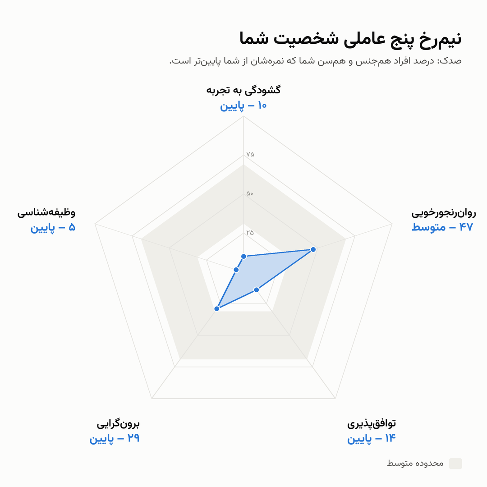 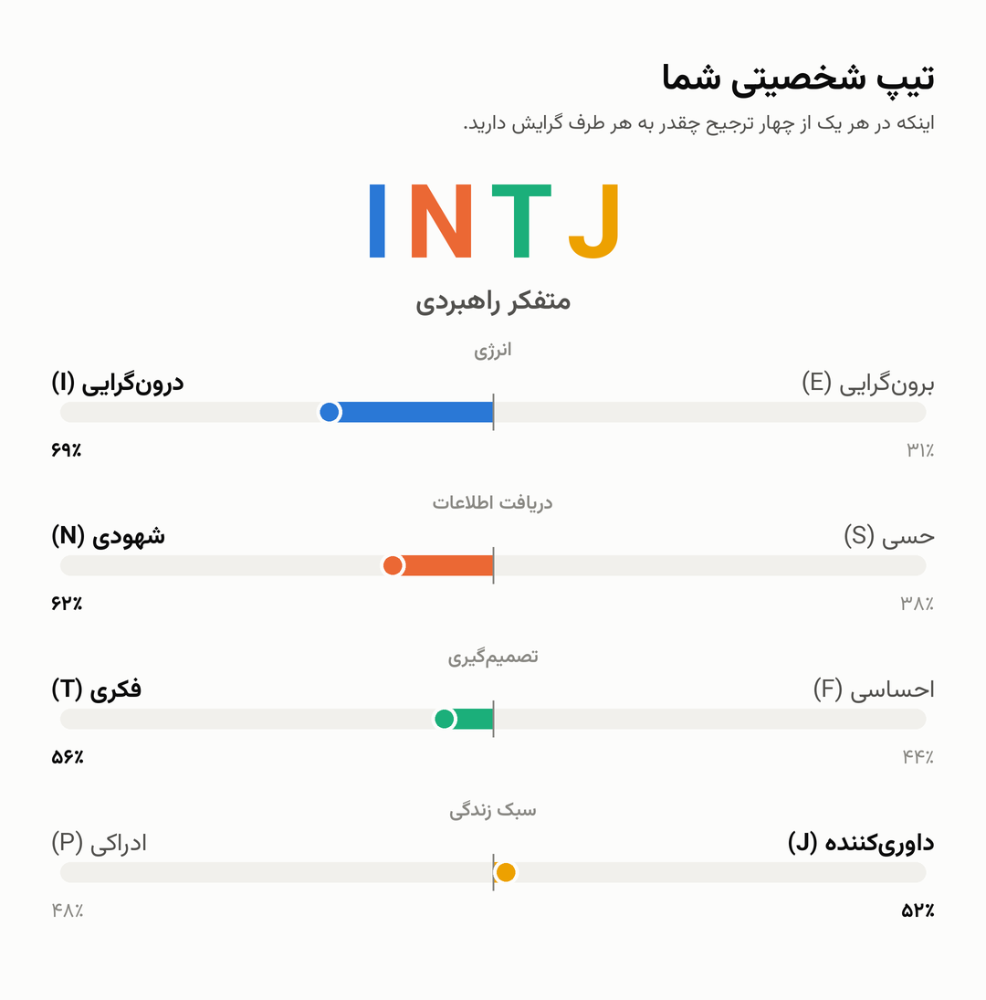

</div>

> [!IMPORTANT]
> These tests are for **self-reflection and education only**. They are not a clinical diagnosis and do not replace a psychologist, psychiatrist or doctor. The mental-health screeners show crisis helplines when an answer suggests risk; if you or someone you know is in danger, contact local emergency services now.

---

## Contents

- [Features](#features)
- [Tests](#tests)
- [Screenshots](#screenshots)
- [Quick start](#quick-start)
- [Configuration](#configuration)
- [Deploy on a server](#deploy-on-a-server)
- [Telegram Stars payments](#telegram-stars-payments)
- [How it works](#how-it-works)
- [Project layout](#project-layout)
- [Adding a test](#adding-a-test)
- [Running the tests](#running-the-tests)
- [Sources, licences and attribution](#sources-licences-and-attribution)
- [Translations that need review](#translations-that-need-review)

---

## Features

- **10 tests in 3 categories**: personality, mental health, and EQ & talents.
- **Short and long form** for almost every test: a quick version and a thorough one.
- **Six languages** for every question, answer, button and result text, including right-to-left Persian and Arabic and Devanagari Hindi, shaped correctly in charts and PDFs (Pillow + Raqm/FriBiDi).
- **Norm-based scoring**: Big Five scores are compared with Johnson's IPIP-NEO norms for the person's sex and age band and reported as T-scores and percentiles.
- **Clear, visual results**: radar charts, ranked bars, two-pole preference bars, a DISC style wheel, a RIASEC hexagon and severity ranges, followed by a plain-language explanation of every category.
- **PDF report** for every result, ready to save or show to a professional.
- **Resume anytime**: every answer is saved to SQLite, so people can stop and continue later, and see their past results.
- **Free and paid versions**: optional Telegram Stars pricing per test form, with refunds and `/paysupport`. Tests whose licences forbid charging always stay free.
- **Safety built in**: a self-harm answer on PHQ-9 triggers crisis helplines for the user's language before any results.
- **Easy to host**: long polling, no domain or HTTPS needed; one `docker compose up` on any small VPS.
- **Easy to extend**: each test is a self-contained folder; register it and it appears in the menu and in the automated tests.

## Tests

| Category | Test | Short form | Long form |
|---|---|---|---|
| Personality | **Big Five** (IPIP-NEO, 5 traits × 6 facets) | 120 questions, ~15 min | 300 questions, ~40 min |
| Personality | **Jungian type, 16 types** (OEJTS, a free MBTI alternative) | 32 questions, ~7 min | 80 questions, ~15 min |
| Personality | **DISC-style behaviour profile** (from IPIP Big Five facets) | 44 questions, ~6 min | 110 questions, ~15 min |
| Mental health | **Depression** | PHQ-9 (9) | PHQ-9 + DASS-42 depression (23) |
| Mental health | **Anxiety** | GAD-7 (7) | GAD-7 + DASS-42 anxiety (21) |
| Mental health | **Depression, anxiety and stress** | DASS-21 (21) | DASS-42 (42) |
| Mental health | **Obsessive-compulsive symptoms** | OCI-R (18) | OCI-R + DOCS (38) |
| EQ & talents | **Emotional intelligence** | WLEIS (16) | WLEIS + SSEIT (49) |
| EQ & talents | **Career interests** (Holland RIASEC) | O\*NET Interest Profiler Short Form (60) | — |
| EQ & talents | **Character strengths** (24 strengths) | IPIP-VIA, 4 per strength (96) | full IPIP-VIA (213) |

## Screenshots

Sample output in Persian (more in [`samples/`](samples), including full PDF reports).

| Big Five: facets of a trait | Jungian type: questionnaire vs. Big Five | DISC style wheel |
|---|---|---|
| 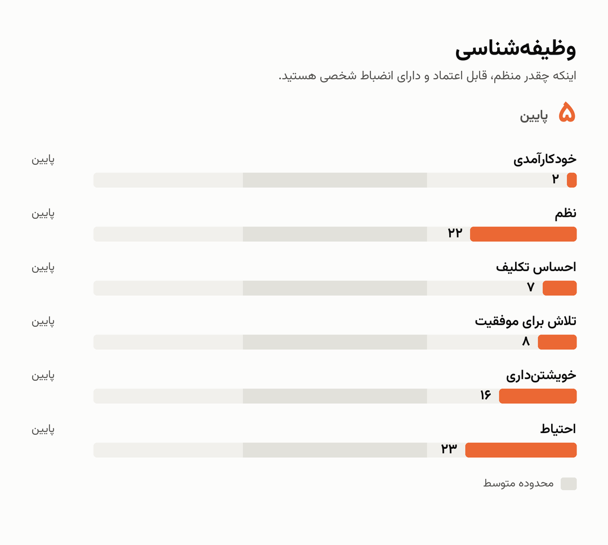 | 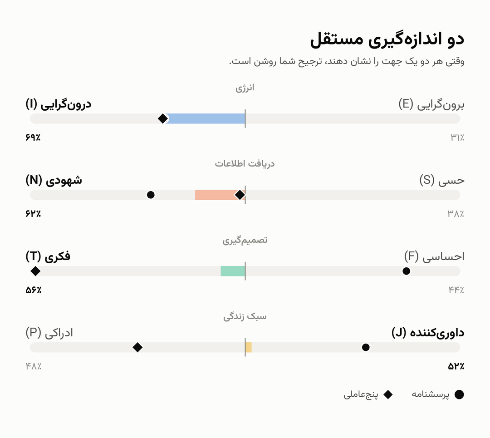 | 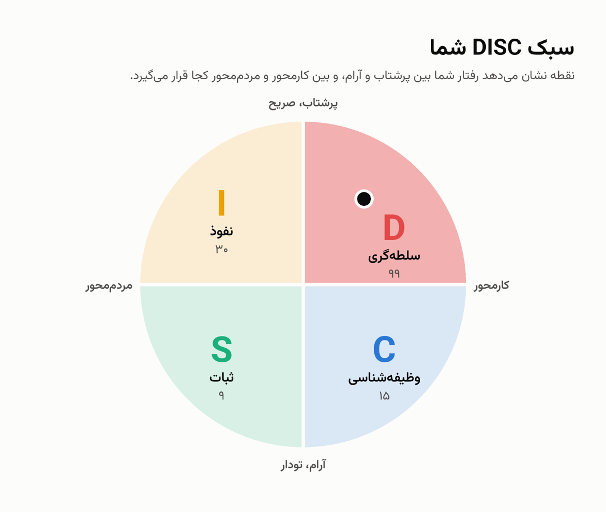 |

| Career interests (RIASEC) | Emotional intelligence | Character strengths |
|---|---|---|
| 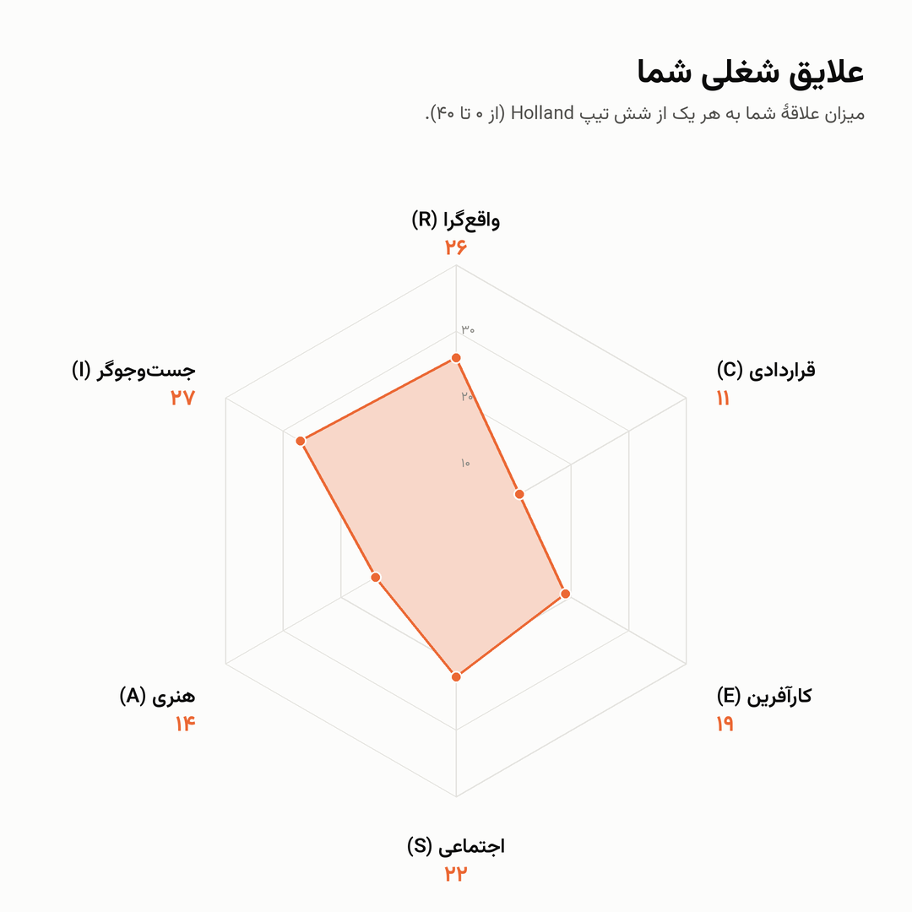 | 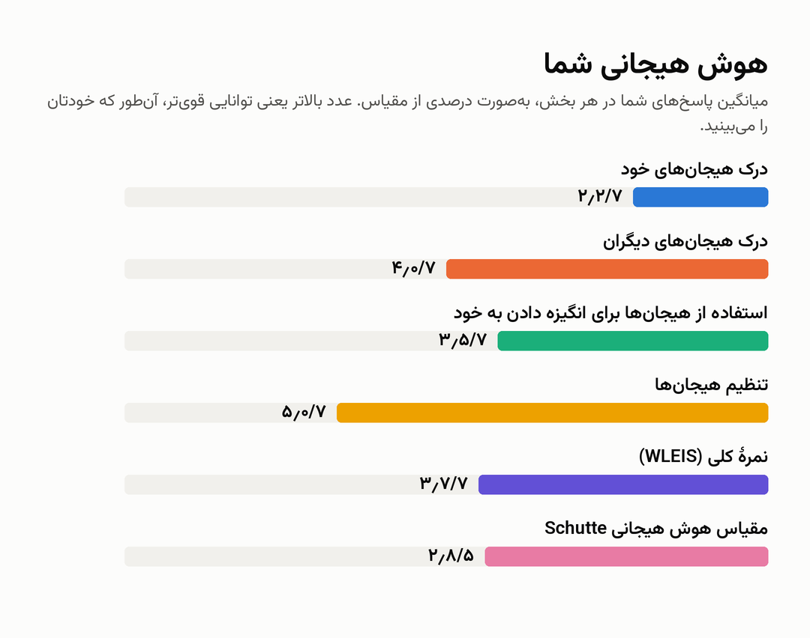 | 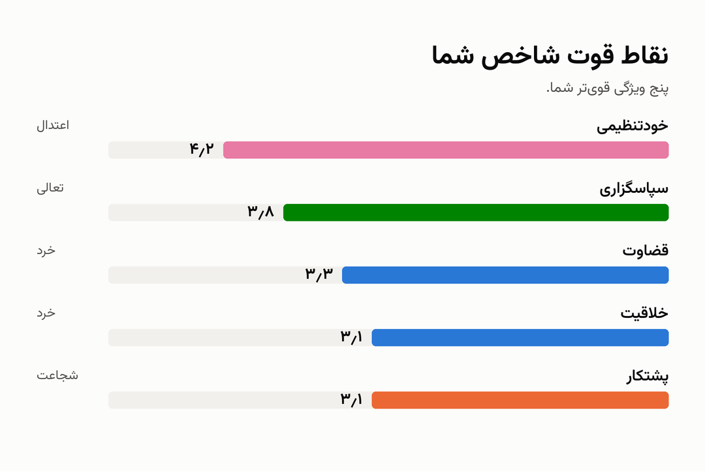 |

| DASS-21 severity | OCD subscales | Hindi (Jungian type) |
|---|---|---|
| 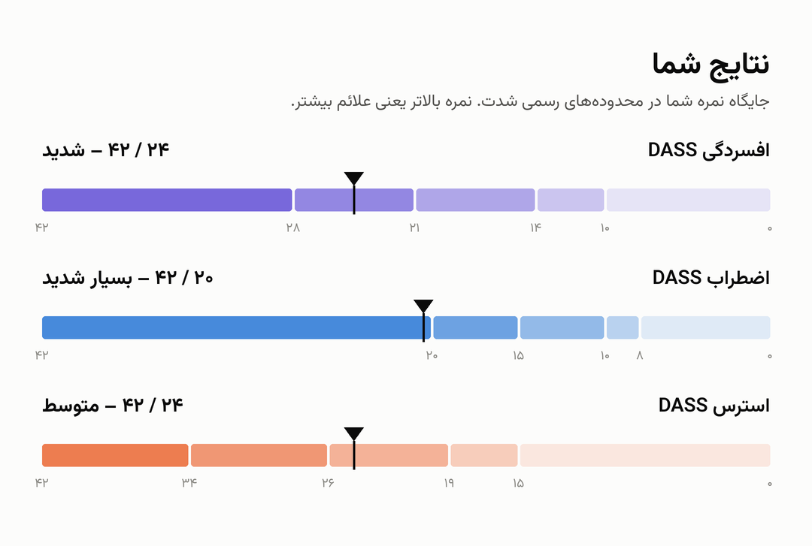 | 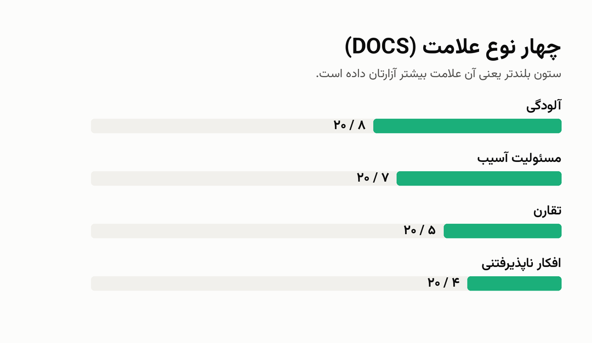 | 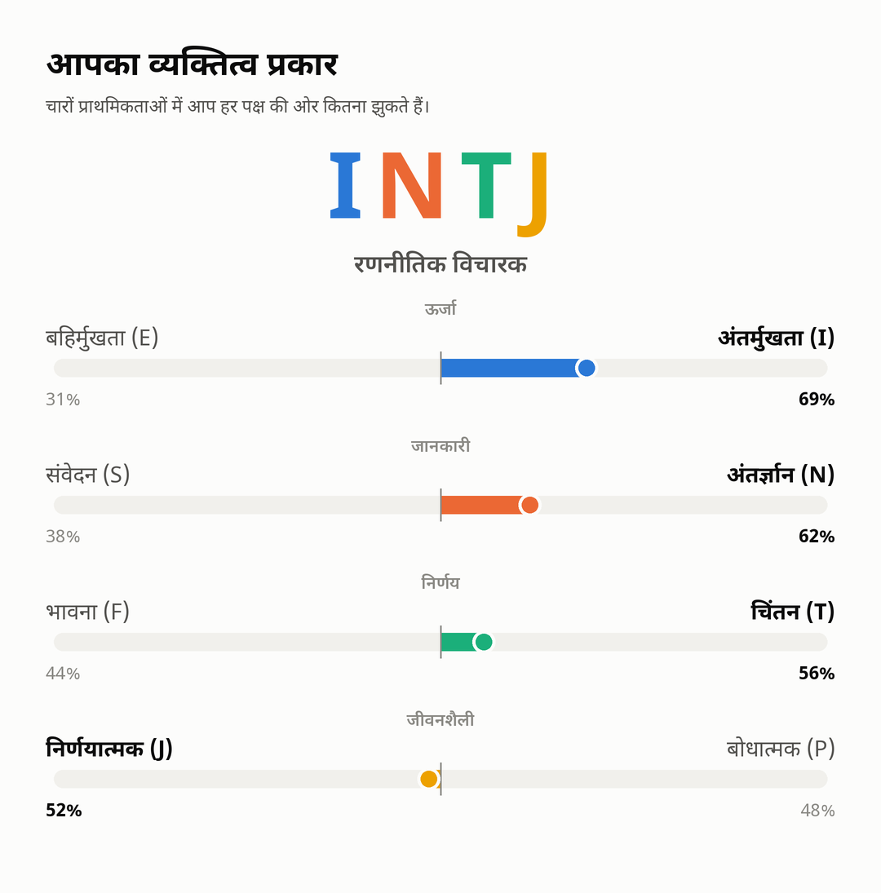 |

Example PDF reports: [Big Five](samples/neo_fa_report.pdf) · [Jungian type](samples/jung_fa_report.pdf) · [DISC](samples/disc_fa_report.pdf) · [DASS](samples/dass_fa_report.pdf) · [Career](samples/career_fa_report.pdf) · [Strengths](samples/strengths_fa_report.pdf)

## Quick start

1. **Create a bot.** In Telegram, open [@BotFather](https://t.me/BotFather), send `/newbot` and copy the token.
2. **Get the code** and install Python 3.10 or newer:

   ```bash
   git clone https://github.com/<your-username>/psytest-bot.git
   cd psytest-bot
   pip install -r requirements.txt
   ```

3. **Create your `.env`** from the example and put your token in it:

   ```bash
   cp .env.example .env          # Windows: copy .env.example .env
   ```

   ```ini
   BOT_TOKEN=123456:ABC...
   PAYMENTS=0
   SUPPORT_CONTACT=@your_username
   ADMIN_IDS=
   ```

   `.env` is in `.gitignore`. Never commit it or share your token.

4. **Start the bot.** When running without Docker, the variables have to be in the environment:

   macOS / Linux:
   ```bash
   set -a; . ./.env; set +a
   python3 -m bot.main
   ```

   Windows (PowerShell):
   ```powershell
   $env:BOT_TOKEN="123456:ABC..."; python -m bot.main
   ```

5. Open your bot in Telegram and send `/start`. Keep the terminal open while you use it.

> On Linux, Persian, Arabic and Hindi text in charts needs FriBiDi (`sudo apt install libfribidi0`). If it is missing, the bot logs a warning at start-up. The Docker image already includes it.

## Configuration

All settings are environment variables (or lines in `.env`):

| Name | Default | Meaning |
|---|---|---|
| `BOT_TOKEN` | *(required)* | Token from @BotFather |
| `DB_PATH` | `neo_bot.sqlite3` | Where users, answers, results and purchases are stored |
| `PAYMENTS` | `0` | `1` charges the Telegram Stars prices in `data/prices.json` |
| `SUPPORT_CONTACT` | `the bot owner` | Shown by `/paysupport`, e.g. `@your_username` |
| `ADMIN_IDS` | *(none)* | Telegram user ids, comma separated, allowed to use `/refund` |

**Bot commands:** `/start` or `/menu` opens the menu, `/language` changes the language, `/paysupport` shows the support contact, `/refund <charge id>` (admins) refunds a purchase.

## Deploy on a server

The bot uses long polling, so the server needs no domain, open port or HTTPS certificate. Any small Linux VPS (1 CPU, 1 GB RAM) is enough.

### With Docker (simplest)

```bash
cp .env.example .env        # then put your token and settings in .env
docker compose up -d --build
docker compose logs -f      # watch it start
```

Answers live in `./data-volume/neo_bot.sqlite3`; back up that file. To update, pull or copy the new code and run `docker compose up -d --build` again.

### Without Docker (systemd)

```bash
sudo apt install python3-venv libfribidi0
sudo useradd --system --home /opt/neo-bot neobot
sudo cp -r . /opt/neo-bot && cd /opt/neo-bot
sudo python3 -m venv venv && sudo venv/bin/pip install -r requirements.txt
sudo cp .env.example .env && sudo nano .env          # add your token
sudo chown -R neobot: /opt/neo-bot
sudo cp deploy/neo-bot.service /etc/systemd/system/
sudo systemctl enable --now neo-bot
journalctl -u neo-bot -f                             # watch the logs
```

Adjust the paths and user in [`deploy/neo-bot.service`](deploy/neo-bot.service) if you install somewhere else. The database is `/opt/neo-bot/neo_bot.sqlite3`; back it up regularly.

## Telegram Stars payments

Payments are off until you set `PAYMENTS=1`. Prices live in [`data/prices.json`](data/prices.json) as Stars per test form; any form not listed is free.

| Paid by default (long form, 50 ⭐) | Always free |
|---|---|
| Big Five (300), DISC (110), Character strengths (213) | Jungian type (licence is non-commercial), EQ (SSEIT may not be charged for), all mental-health screeners, career interests, and every short form |

- A priced form shows "⭐ 50" on its button. Tapping it sends a Telegram invoice; after payment the test starts at once and the purchase is remembered, so the person can retake that form free.
- `/paysupport` shows `SUPPORT_CONTACT`. Telegram requires bots that take payments to answer this command.
- `/refund <charge id>` (admins only) returns the Stars and removes the purchase. The charge id is in the `purchases` table of the database.
- Telegram also requires terms of service for paid bots; add a link to yours in the bot's description via @BotFather.
- Stars you earn are withdrawn through @BotFather / Fragment; check Telegram's current rules for your country.

## How it works

### User flow

`/start` → language → main menu (categories, continue an unfinished test, my results, language, about) → category → test description, short or long form → sex and age group (asked once, remembered, can be changed) → instructions → questions (answer buttons, progress bar, back button) → results: an album of charts, explanation messages and a PDF report.

### Big Five scoring (IPIP-NEO)

1. Each answer is 1 to 5. Reverse-keyed questions are flipped (6 − answer).
2. Answers are summed per facet (4 or 10 questions) and per trait (6 facets).
3. Each sum is compared with Johnson's norms for the person's sex and age band: `T = 50 + 10 × (raw − mean) / SD`.
4. The percentile comes from the normal distribution (T 60 ≈ higher than 84% of people).
5. Level: T below 45 is low, 45–55 is average, above 55 is high (Johnson's cut-offs).

If someone doesn't give sex as male or female, the average of the male and female norms is used. Scoring was checked against Johnson's reference method (as implemented in five-factor-e) on 200 random answer sets; T-scores matched within rounding (max difference 0.05).

### Jungian type (OEJTS)

- **Short form (32 pairs):** each answer runs from 1 (fully the left statement) to 5 (fully the right). The 8 answers per preference are summed (8–40) and turned into a 0–100% lean toward I, N, T or P; above 50% gives that letter, otherwise E, S, F or J. Clarity is the distance from 50%: slight, moderate, clear or very clear.
- **Long form (80):** adds 48 IPIP-NEO-120 questions from the Big Five facets that track each preference (E: friendliness, gregariousness, assertiveness; N: imagination, adventurousness, intellect; F: sympathy, altruism, emotionality; J: orderliness, self-discipline, cautiousness), scored against Johnson's norms. The final lean averages the questionnaire and Big Five leans, and the report says where the two disagree.

### DISC-style profile

There is no free, validated DISC questionnaire, so each style is scored from the IPIP-NEO facets that describe it, against Johnson's norms:

| Style | Facets (+ raises, − lowers) |
|---|---|
| **D** Dominance | assertiveness +, cooperation −, achievement-striving + |
| **I** Influence | friendliness +, gregariousness +, cheerfulness + |
| **S** Steadiness | cooperation +, anger −, excitement-seeking − |
| **C** Conscientiousness | orderliness +, cautiousness +, dutifulness + |

A style's T-score is the mean of its signed facet T-scores. The main style is the highest; a second style is named when it is at least the 60th percentile and within 15 points of the first; the profile is "balanced" when all four are within 15 points. The style wheel places a dot at (I + S − D − C, D + I − S − C). This mapping is the project's own and has not been validated against a commercial DiSC® assessment.

### Mental-health screeners

Scores are raw sums compared with the published severity ranges (no sex or age needed):

| Measure | Range | Bands |
|---|---|---|
| PHQ-9 | 0–27 | 0–4 minimal, 5–9 mild, 10–14 moderate, 15–19 moderately severe, 20–27 severe |
| GAD-7 | 0–21 | 0–4 minimal, 5–9 mild, 10–14 moderate, 15–21 severe |
| DASS depression | 0–42 | 0–9 normal, 10–13 mild, 14–20 moderate, 21–27 severe, 28+ extremely severe |
| DASS anxiety | 0–42 | 0–7, 8–9, 10–14, 15–19, 20+ |
| DASS stress | 0–42 | 0–14, 15–18, 19–25, 26–33, 34+ |
| OCI-R | 0–72 | 21+ above the clinical cut-off; six subscales of 0–12 |
| DOCS | 0–80 | 21+ above the cut-off; four dimensions of 0–20 |

DASS-21 scores are doubled so the DASS-42 ranges apply. Long forms that combine two questionnaires report whether they agree.

**Safety:** any answer above "not at all" on PHQ-9 item 9 (thoughts of death or self-harm) shows crisis helplines for the user's language (`crisis_lines` in `data/ui.json`) before the results. Moderately severe or worse results recommend seeing a professional. The PDF lists every answer so it can be shown to a doctor. `tests/test_safety.py` checks these rules and the cut-offs.

### EQ and talents

- **Emotional intelligence:** WLEIS subscales (own emotions, others' emotions, use of emotion, regulation) are the mean of 4 answers on a 7-point scale; SSEIT is the sum of 33 answers on a 5-point scale (items 5, 28, 33 reversed). Because published norms differ widely between countries, levels are tied to the answer scale (WLEIS mean < 4 low, > 5.5 high; SSEIT mean < 3 low, > 4 high).
- **Career interests:** each Holland area (Realistic, Investigative, Artistic, Social, Enterprising, Conventional) is the sum of 10 activities scored 0–4. The Holland code is the three highest areas. Charts: a RIASEC hexagon and ranked bars.
- **Character strengths:** each strength is the mean of its items on the IPIP 1–5 scale, ranked within the person's own profile as VIA does; the top five are the signature strengths. The short form (3 positive + 1 negative item per strength) has not been separately validated.

## Project layout

```
bot/main.py              the Telegram bot (one flow for every test, payments, commands)
core/engine.py           the Instrument interface (items, choices, scoring, report) and test registry
core/charts.py           reusable charts: radar, bars, two-pole bars, quadrant wheel, severity ranges
core/draw.py             text drawing with correct shaping for all 6 scripts (Pillow + Raqm)
core/pdf.py              PDF report pages
core/storage.py          SQLite: users (language, sex, age), test sessions, purchases
core/i18n.py, data/ui.json   bot buttons and messages in 6 languages
data/prices.json         Telegram Stars prices per test form
assets/fonts/            Noto Sans, Noto Sans Devanagari, Vazirmatn (SIL Open Font License)
instruments/<test>/      one folder per test: questions, scoring, texts/<lang>.json, charts
  neo/                   items_120.json, items_300.json, choices.json, norms.json, scoring.py
  jung/                  oejts_pairs.txt (32 statement pairs in 6 languages), type descriptions
  disc/, screeners/, eq/, career/, strengths/
tools/build_data.py      rebuilds the NEO data files from tools/sources/
tools/sources/           original item lists, translations and third-party licences
tests/                   end-to-end flow, payment and safety tests against a fake Telegram
samples/                 example charts and PDF reports
deploy/neo-bot.service   systemd unit
Dockerfile, docker-compose.yml, .env.example
```

## Adding a test

1. Create `instruments/<id>/__init__.py` with a subclass of `core.engine.Instrument` (see `instruments/neo`).
2. Put its questions and `texts/<lang>.json` (with a `test` section: title, about, instructions) in that folder.
3. Register it in `instruments/__init__.py`. It then appears in its category menu, and `tests/test_flow.py` covers it automatically.

## Running the tests

```bash
pip install -r requirements-dev.txt
python -m pytest tests
```

The suite runs every test and form through a fake Telegram and renders every report, so it takes about 2 minutes.

## Sources, licences and attribution

| Material | Source | Licence / terms |
|---|---|---|
| Big Five items | International Personality Item Pool ([ipip.ori.org](https://ipip.ori.org)); order and keys from Johnson's IPIP-NEO | Public domain |
| 120-item translations (ru, ar, hi, fa, fr) | bigfive-test, `b5-johnson-120-ipip-neo-pi-r` | MIT (two Hindi typos fixed) |
| Extra 180 long-form items (ru, ar, hi, fa, fr) | Translated for this project (`tools/sources/translations_300_extra.txt`) | — |
| Norms and reverse keys | Johnson (2014), via five-factor-e by NeuroQuest | MIT ([licence](tools/sources/LICENSE_five_factor_e)) |
| Jungian type items | Open Extended Jungian Type Scales 1.2, Eric Jorgenson (Open Psychometrics) | CC BY-NC-SA 4.0, **must stay free** |
| PHQ-9, GAD-7 | Spitzer, Kroenke, Williams et al. (Pfizer) | Free to reproduce, translate and distribute |
| DASS-21, DASS-42 | Lovibond & Lovibond (1995) | Public domain |
| OCI-R, DOCS | Foa et al. (2002); Abramowitz et al. (2010) | Free for clinical and research use; check with the authors before charging |
| WLEIS | Wong & Law (2002), items from Extremera et al. (2019) | No explicit licence found; ask the authors before charging |
| SSEIT (Assessing Emotions Scale) | Schutte et al. (1998) | Free use, but not when people are charged to take it |
| O\*NET Interest Profiler | U.S. Department of Labor, Employment and Training Administration (USDOL/ETA) | O\*NET Tools Developer License; the bot shows the required attribution and modification notice. Register your use at [onetcenter.org/register](https://www.onetcenter.org/register) |
| IPIP-VIA | [ipip.ori.org](https://ipip.ori.org) | Public domain |
| Fonts | Noto Sans, Noto Sans Devanagari, Vazirmatn | SIL Open Font License ([OFL.txt](assets/fonts/OFL.txt)) |
| Result texts, type descriptions, DISC texts, screener translations | Written for this project | — |

**Trademarks:** MBTI® and Myers-Briggs Type Indicator® are trademarks of The Myers-Briggs Company; DiSC® is a trademark of John Wiley & Sons; VIA® is a trademark of the VIA Institute on Character. This project is not affiliated with or endorsed by any of them, and the bot says so. The official NEO-PI-3 and NEO-FFI are copyrighted by PAR and are **not** used anywhere here.

## Translations that need review

Contributions from native speakers are very welcome, especially for:

- The 180 extra long-form Big Five questions in the 5 non-English languages.
- The Jungian statement pairs and type descriptions, DISC texts, and EQ, career and strengths questions and texts in the 5 non-English languages.
- All screener questions and answer choices (PHQ-9, GAD-7, DASS, OCI-R, DOCS). Ideally replace them with the official validated translations (e.g. from [phqscreeners.com](https://www.phqscreeners.com)).
- The crisis helpline numbers in `data/ui.json` for each country you target.
- The Hindi short-form Big Five questions, the weakest of the community translations.

See [`PLAN_fa.md`](PLAN_fa.md) for the roadmap (in Persian).

---

<div align="center">
<sub>Not a medical device. Results are for self-understanding and should be interpreted with care.</sub>
</div>
